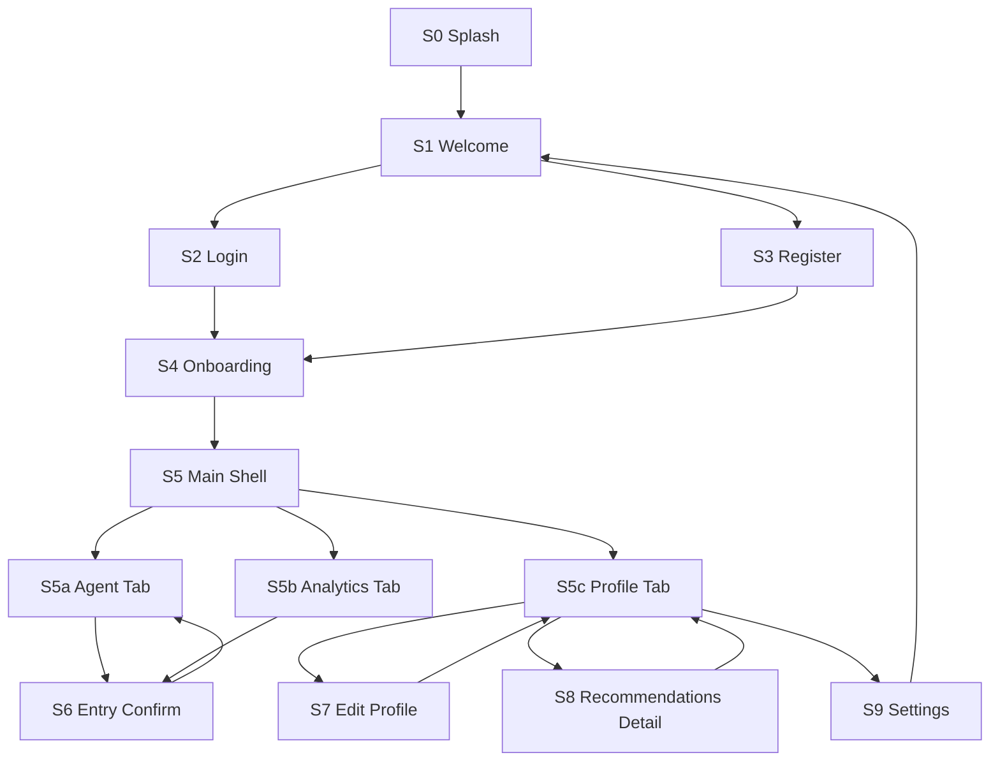
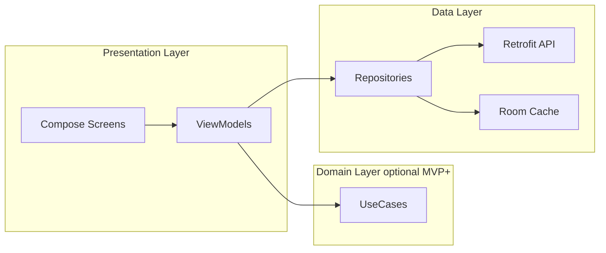
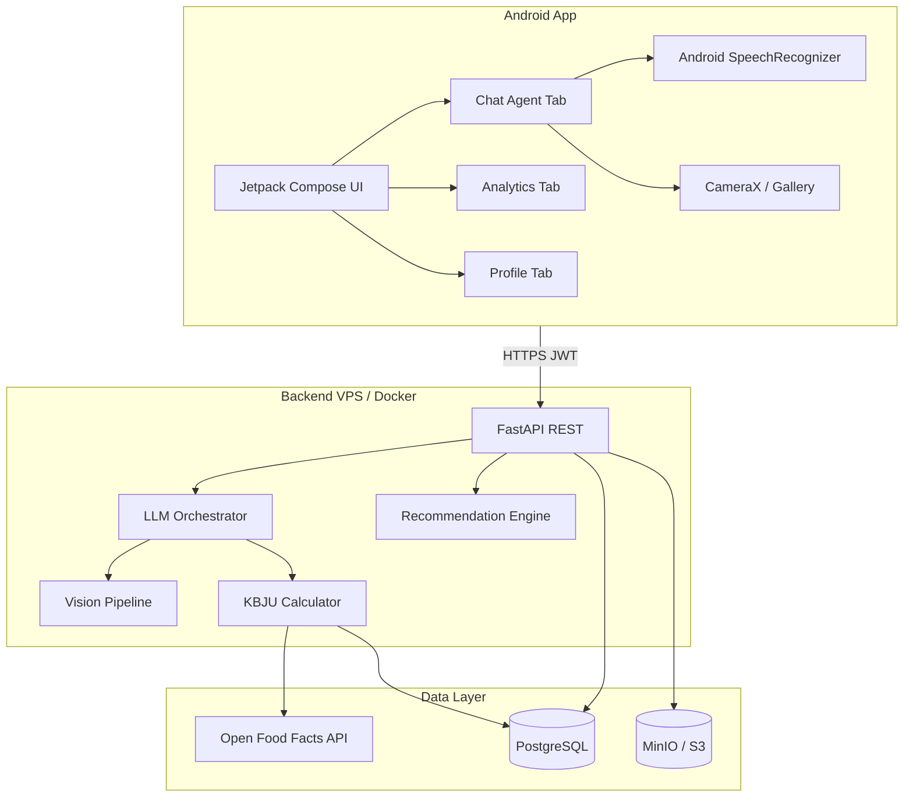

# NutriAI — план проекта (ВКР)

Единый документ: задание 2 (UI и архитектура клиента) + стек и backend.

---

## Задание 2. Проектирование интерфейса и архитектуры (MVP, только UI)

Документ для пояснительной записки / защиты ВКР. Бизнес-логика и API не реализуются — только структура экранов, навигация, визуальная система и архитектурное решение.

**Реализация UI:** статичные Compose-экраны и `@Preview` в [`../android/`](../android/).

### 2.1. Дизайн-система MVP (Material 3)

| Элемент | Значение |
|---------|----------|
| Платформа | Android, портрет, min width 360 dp |
| Стиль | Material 3, светлая тема (+ опционально dark для демо) |
| Акцент | `#2D6A4F` (здоровье / «свежесть»), контейнеры `#D8F3DC` |
| Нейтрали | Surface `#FFFBFE`, фон `#F6F8F6`, текст primary `#1B1B1F` |
| Шриф | **Roboto** / system default M3 (typography scale: Title Large, Body Medium, Label Large) |
| Скругления | Cards 16 dp, chips 8 dp, bottom sheet 28 dp top |
| Иконки | Material Symbols Outlined (mic, photo_camera, analytics, person, restaurant) |
| Touch | Минимум 48 dp для mic / send / tab |

**Принципы UX:** один главный сценарий — «сказал/написал/фото → карточка КБЖУ»; вторичный — «посмотреть прогресс»; третий — «профиль и рекомендации».

### 2.2. Карта экранов (инвентарь MVP)

| ID | Экран | Тип | Назначение |
|----|--------|-----|------------|
| S0 | Splash | одноразовый | Логотип NutriAI, 1–2 с |
| S1 | Welcome | auth gate | Вход / регистрация |
| S2 | Login | форма | Email + пароль |
| S3 | Register | форма | Email + пароль + имя |
| S4 | Onboarding (3 шага) | wizard | Цель, антропометрия, активность |
| S5 | Main (Bottom Nav) | shell | Контейнер 3 вкладок |
| S5a | Tab Agent | primary | Чат с ИИ |
| S5b | Tab Analytics | secondary | Диаграммы + таблица дня |
| S5c | Tab Profile | secondary | Профиль + рекомендации |
| S6 | Entry Confirm | modal/sheet | Подтверждение порции и КБЖУ (mock) |
| S7 | Edit Profile | форма | Изменение веса, цели |
| S8 | Recommendations Detail | push | Развёрнутый обед/ужин |
| S9 | Settings | push | Выход, политика, about |

Статичный MVP без логики: все данные — **fake state** в Compose `@Preview` / hardcoded lists.

### 2.3. Прототипы основных экранов (low-fi → структура блоков)

**S1 Welcome**

```
┌─────────────────────────────┐
│         [Logo NutriAI]      │
│   Дневник питания с ИИ      │
│                             │
│  ┌─────────────────────┐    │
│  │   Войти             │    │
│  └─────────────────────┘    │
│  ┌─────────────────────┐    │
│  │   Создать аккаунт   │    │  outline
│  └─────────────────────┘    │
└─────────────────────────────┘
```

**S5a Tab Agent (главный)**

```
┌─────────────────────────────┐
│ NutriAI          сегодня ▼  │  TopAppBar
├─────────────────────────────┤
│ ┌─ AI ─────────────────┐    │
│ │ Что вы ели сегодня?   │    │
│ └───────────────────────┘    │
│        ┌─ User ─────────┐    │
│        │ Овсянка с бананом│  │
│        └──────────────────┘  │
│ ┌─ AI ─────────────────┐    │
│ │ Карточка записи       │    │
│ │ Овсянка 250g          │    │
│ │ 420 kcal · Б24 Ж8 У72 │    │
│ │ [Подтвердить][Изм.]   │    │
│ └───────────────────────┘    │
├─────────────────────────────┤
│ [📷] [ сообщение... ] [🎤][➤]│  input bar
├─────────────────────────────┤
│  Агент  │ Аналитика │ Профиль│  BottomNav
└─────────────────────────────┘
```

**S5b Tab Analytics**

```
┌─────────────────────────────┐
│ Аналитика        неделя ▼   │
├─────────────────────────────┤
│ Сегодня  1 840 / 2 200 kcal │  linear progress
│ Б · Ж · У  (3 mini bars)    │
├─────────────────────────────┤
│ ┌─ столбчатый график ─────┐ │  Vico placeholder
│ │ Пн Вт Ср Чт Пт Сб Вс    │ │
│ └─────────────────────────┘ │
│ ┌─ доли БЖУ (donut) ──────┐ │
│ └─────────────────────────┘ │
├─────────────────────────────┤
│ Приём пищи │ Ккал │ Б │ Ж │ У│  table header
│ Завтрак    │ 420  │..│..│..│  rows...
│ Обед       │ 650  │..│..│..│
└─────────────────────────────┘
```

**S5c Tab Profile + рекомендации**

```
┌─────────────────────────────┐
│ Профиль              ⚙      │
├─────────────────────────────┤
│ (avatar)  Антон, цель: −5кг │
│ 82 кг · 178 см · муж        │
│ [Изменить профиль]          │
├─────────────────────────────┤
│ Рекомендации на сегодня     │
│ ┌ Обед ──────────────────┐  │
│ │ Куриный салат + гречка  │  │
│ │ ~520 kcal · остаток Б/Ж/У│ │
│ │ [Подробнее]             │  │
│ └─────────────────────────┘  │
│ ┌ Ужин ──────────────────┐  │
│ │ Творог + ягоды          │  │
│ └─────────────────────────┘  │
└─────────────────────────────┘
```

**S6 Entry Confirm (bottom sheet)**

```
┌─────────────────────────────┐
│ ─── drag handle ───         │
│ Проверьте запись            │
│ Борщ домашний               │
│ Порция: [−] 300g [+]        │
│ Kcal 180 · Б6 · Ж8 · У12    │
│ [Сохранить в дневник]       │
│ [Отмена]                    │
└─────────────────────────────┘
```

**S4 Onboarding (шаг 1 из 3 — пример)**

```
┌─────────────────────────────┐
│ ● ○ ○           Пропустить  │
│ Ваша цель                   │
│ ( ) Похудение               │
│ (•) Поддержание формы       │
│ ( ) Набор массы             │
│            [Далее]          │
└─────────────────────────────┘
```

### 2.4. Граф навигации



**Правила навигации (Navigation Compose):**

- `NavHost` корень: auth graph → main graph.
- Main: один `Scaffold` + `NavigationBar`; вкладки — **sibling routes** с `saveState` / `restoreState`.
- S6 — `ModalBottomSheet`, не отдельный back stack root.
- S7, S8, S9 — `NavController.navigate` с `popUpTo` main.

### 2.5. Архитектура клиента (паттерны, кратко)



| Уровень | Паттерн | Содержимое |
|---------|---------|------------|
| UI | **MVVM** | Screen composables + `*ViewModel` + `UiState` data class |
| Навигация | **Single Activity**, Navigation Compose | Один `MainActivity`, type-safe routes (Kotlin sealed / строки) |
| DI | **Hilt** | Модули network, repository, dispatchers |
| Сеть | **Repository** | Абстракция над API; UI не знает Retrofit |
| Состояние | **Unidirectional Data Flow** | Events ↑ Actions ↓ State |
| Backend | **Layered / Clean-lite** | routers → services → repositories → SQLAlchemy |
| ИИ | **Orchestrator service** | Один сервис агента: prompt + JSON schema + post-process KBJU |
| Async | **Kotlin Coroutines** + **Flow**; backend **async** FastAPI | |

**MVP UI-only (текущее задание):** только `presentation` — экраны + mock data в Preview, без Hilt/Retrofit.

### 2.6. Стек технологий (сводка для задания 2)

- **Mobile:** Kotlin, Jetpack Compose, Material 3, Navigation Compose, Hilt, Retrofit, Room, CameraX, SpeechRecognizer, Vico.
- **Backend:** Python, FastAPI, Pydantic, SQLAlchemy, PostgreSQL, MinIO, JWT.
- **AI:** LLM + Vision API, structured JSON, TDEE + meal recommendations; Whisper — fallback STT.

---

# NutriAI: мобильный стек (Android, ВКР)

## Критерии выбора

Для **только Android** и требования «полностью функционально» оптимален **нативный стек Kotlin + Jetpack Compose**: это однозначно «мобильная разработка» для комиссии, хорошая интеграция с **микрофоном**, **камерой/галереей**, **уведомлениями** и **Material Design 3** без лишних мостов. Один общий **REST API** позволяет параллельно вести работу Никите (клиент) и Гураму (ИИ/backend), а Данилу — наполнять базу продуктов и сценарии QA.

---

## Общая архитектура



---

## 1. Мобильное приложение (Никита — Frontend/Mobile)

| Слой | Технология | Зачем |
|------|------------|--------|
| Язык | **Kotlin 2.x** | Стандарт Android и ВКР |
| UI | **Jetpack Compose** + **Material 3** | Чат, профиль, таблицы, навигация |
| Архитектура | **MVVM** + **Clean-ish** | UI → ViewModel → Repository |
| DI | **Hilt** | Внедрение API, репозиториев |
| Сеть | **Retrofit 2** + **OkHttp** + **Kotlinx Serialization** | REST к FastAPI |
| Локальный кэш | **Room** (опционально) | Офлайн-просмотр дневника |
| Навигация | **Navigation Compose** | Агент, аналитика, профиль |
| Голос | **SpeechRecognizer** → текст; fallback **Whisper API** | |
| Фото | **CameraX** + **Photo Picker** + **Coil** | |
| Графики | **Vico** или **YCharts** | КБЖУ по дням/неделям |
| Auth UI | JWT в **DataStore** / Encrypted prefs | |
| Сборка | minSdk **26**, targetSdk **35** | |

---

## 2. Backend и ИИ (Гурам — AI/Backend)

| Компонент | Технология |
|-----------|------------|
| API | **Python 3.11+**, **FastAPI**, **Pydantic v2** |
| ORM | **SQLAlchemy 2** + **Alembic** |
| Auth | **JWT** |
| LLM | GPT-4o-mini / Gemini Flash + **Vision** |
| Рекомендации | **TDEE** (Mifflin–St Jeor) + LLM |

**Эндпоинты (черновик):** `/auth/*`, `/users/me`, `/agent/message`, `/media/upload`, `/diary`, `/stats/*`, `/recommendations/meals`.

---

## 3. Данные (Данил — Data/UX/QA)

PostgreSQL, MinIO, таблица `food_items`, Open Food Facts, метрики точности распознавания.

---

## 4. DevOps

Docker Compose (`api`, `postgres`, `minio`), VPS + HTTPS, секреты в `.env`.

---

## 5–8. Freemium, роли команды, риски, версии

См. полные таблицы в истории проекта; ключевой итог:

**Клиент:** Kotlin + Compose + Hilt + Retrofit + Room + CameraX + SpeechRecognizer + Vico.  
**Сервер:** FastAPI + PostgreSQL + MinIO + LLM/Vision.  
**Деплой:** Docker Compose на VPS, HTTPS, JWT.

---

## Roadmap (чеклист)

- [x] Задание 2: UI прототипы в Compose Preview (`android/`)
- [ ] Monorepo: `backend/` + `docker-compose.yml`
- [ ] Backend: auth, diary, stats, Swagger
- [ ] AI pipeline: agent, KBJU, recommendations
- [ ] База продуктов Open Food Facts
- [ ] Полный Android MVP с API
- [ ] VPS + APK для защиты
